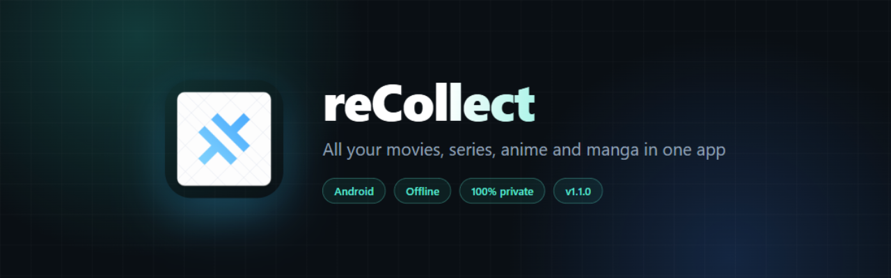
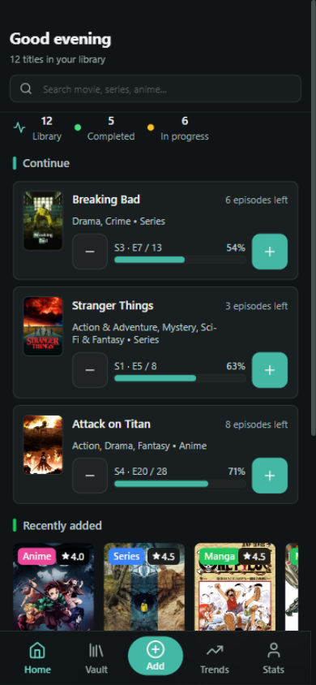
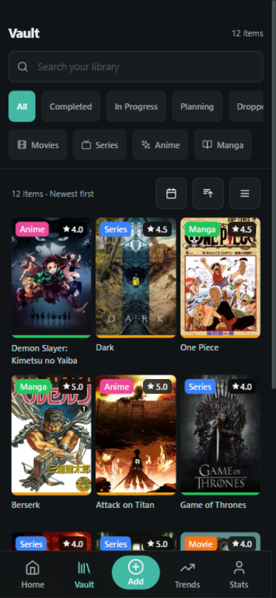
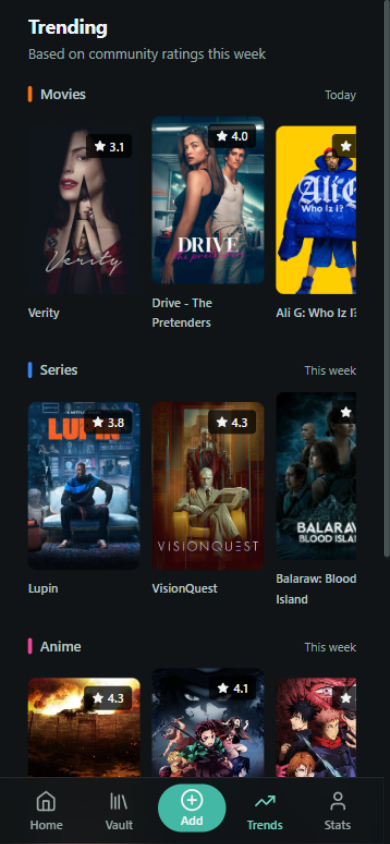
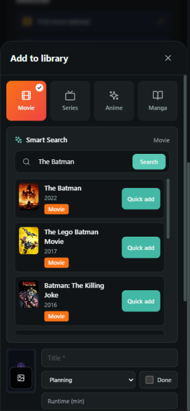
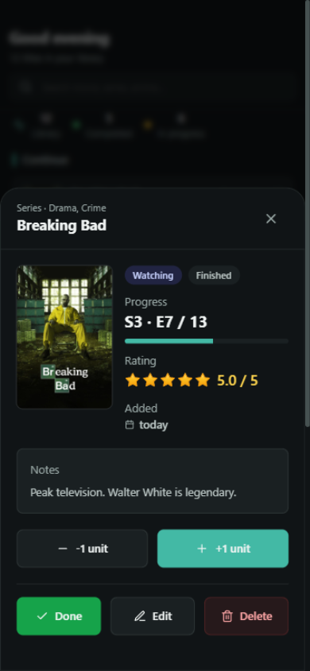
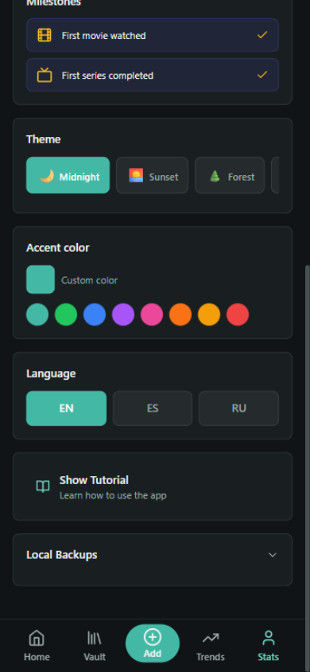

  

**[⬇️ Download reCollect v1.2.0](reCollect-v1.2.0.apk)** · [What's new](#-whats-new) · [Installation](#-installation)

---

## 🎬 What is reCollect?

**reCollect** is your personal entertainment collection: an Android app to keep track of everything you **watch** (movies, series and anime) and everything you **read** (manga), with a polished dark design built mobile-first.

Unlike other tracking apps, **your data is 100% yours**: it stays on your device, works offline, and you can export it anytime. No accounts, no sign-up, no servers.

## ✨ Features

**Your collection**
- 📺 Track **movies, series, anime and manga** in one place
- ➕ One-tap progress: add an episode or chapter with a single button and watch your progress update in real time
- 🎯 Watch states: *In progress, Completed, Planning, Dropped*
- ⭐ Rate your titles with **half-star precision** (3.5, 4.0…)
- 🔍 Vault with search, type & status filters, sorting, and list or grid views

**Discover what to watch**
- 🔥 **Trending** section with posters and community ratings (data from [TMDB](https://www.themoviedb.org))
- 🛡️ Duplicate detection when you add a title you already own

**Make it yours**
- 🎨 **Color themes** (Forest, Ocean, Rose…) plus a **custom accent color**
- 🌍 Available in **English, Spanish and Russian**
- 🏆 **Achievements** that unlock as you use the app
- 👋 Welcome tutorial to get you started in 30 seconds

**Your data, safe**
- 💾 **Offline-first**: everything works without a connection
- 📥📤 **Backup & restore** to a single JSON file, with an automatic snapshot before any import
- 🧯 Data protection under the hood: atomic writes, quarantine for corrupted data, and undoable actions

## 📸 Screenshots

| Home & progress | Your vault | Trending |
|:---:|:---:|:---:|
|  |  |  |
| **Add & smart search** | **Detail & ratings** | **Personalization** |
|  |  |  |

## 📥 Installation

> **Requirements**: Android 7.0 or newer · ~3.4 MB of space
> **Devices**: works on phones and tablets from any manufacturer (Samsung, Xiaomi, Pixel, Motorola…) — the app contains no device-specific code and adapts to any screen size and aspect ratio, including the latest Android 15+ edge-to-edge displays.

1. **Download** the APK: **[reCollect-v1.2.0.apk](reCollect-v1.2.0.apk)** (download button at the top right of the page that opens)
2. **Open the file** on your phone
3. If Android warns you about installing from an *unknown source*, accept — this is normal for apps installed outside the Play Store. The app is digitally signed by its author
4. Done! Open reCollect and add your first title 🎉

<b>Installation problems?</b>

- **"Installation blocked"**: go to Settings → Security (or Settings → Apps → Special access) and allow *Install unknown apps* for your browser or file manager.
- **"App not installed"**: make sure the APK downloaded completely (it should weigh ~3.4 MB) and that you're on Android 7.0 or newer.
- **Updating from an older version**: just install the new APK on top; all your data is preserved.

## 🔒 Privacy

- Your data lives **only on your device** (local storage). Nobody else can see it — not even me.
- reCollect **does not collect, track or send** any personal information to any server.
- The only network usage is fetching **trending titles and search results from TMDB**. Without a connection, the app keeps working as usual.
- Storage permissions are used exclusively to **export/import your backups**.

> This product uses the TMDB API but is not endorsed or certified by TMDB.

## ❓ FAQ

**Is it free?**
Yes, completely. No ads, no purchases, no subscriptions.

**Is there an iOS version?**
Not for now — Android only.

**Why isn't it on the Play Store?**
It's a personal project shared with friends. Publishing on the Play Store takes extra paperwork; it may come in the future.

**What happens if I uninstall the app?**
Your data is deleted. Before uninstalling or switching phones, export a backup from **Stats → Backups**.

**Can I move my data to another phone?**
Yes: export the backup on the old phone, send the file to yourself (WhatsApp, email…), and import it on the new one.

## 📋 What's new

### v1.2.0 — *October 2026*

UI refinement pass:

- ▶️ **Continue** section reworked: unwatched movies get a direct *Mark as watched* button instead of a meaningless progress stepper; series/anime/manga keep the stepper with larger 44 px buttons
- 🎛️ **Vault filters** are now two always-visible rows (status + type with icons) — type filters are no longer hidden behind a horizontal scroll
- 🧩 **Add form**: the selected type tile now shows its own color gradient with a check badge (previously barely visible), and the rating control is compact inline stars
- 🌍 Progress text like "6 episodes left" is now fully localized, and progress bars follow your theme accent color

### v1.1.0 — *October 2026*

Big quality-of-life update:

- 🛡️ **Deep data safety**: atomic writes, quarantine if data gets corrupted, and an automatic snapshot before every restore/import
- ↩️ **Undo** destructive actions (delete, mark as completed…) from snackbar notifications
- 🛡️ **Duplicate warning** when adding a title that's already in your collection
- 🎨 **Forest / Ocean / Rose themes** + a pick-your-own accent color
- 🌍 Interface in **English, Spanish and Russian**
- ⭐ Half-star ratings
- 🏆 Achievement system
- 👋 **First-run tutorial** for new users
- 🖼️ Automatic cover compression (saves space without losing quality)
- 📱 Adapted to Android 15+ edge-to-edge *safe areas*

<b>v1.0.0 — first release</b>

- Movie, series, anime and manga tracking with per-episode/chapter progress
- Vault with filters, search, sorting and views
- Trending titles from TMDB
- JSON backup & restore
- Dark mobile-first design, 100% offline

## 🛠️ Technologies

React · Vite · Tailwind CSS · Zustand · Capacitor · Data from TMDB

*(The app is distributed as a compiled APK only; the source code is not public.)*

## 📄 License

reCollect is **proprietary** software — see [LICENSE](LICENSE). You may use it and share it with friends as-is; decompiling it, reusing its code or assets, or distributing it for profit is not allowed.

---

  Made with ❤️ by a movie & manga enthusiast · Suggestions? Drop me a line!

